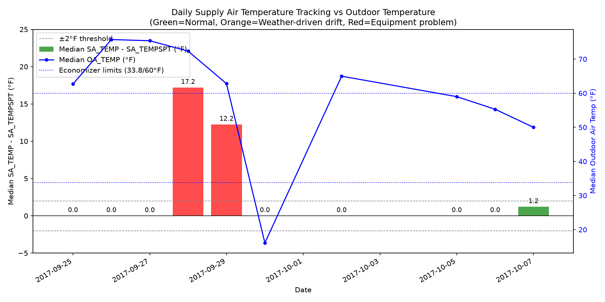

# AHU Supply Air Temperature Tracking Analysis

**Source file:** 02_data/datasets/hvac-ahu/ahu_trend_2017-09-25_to_2017-10-08.csv
**Analysis date:** 2026-11-11

## 1. Data Fixes Applied

### Fix 1: Duplicate Timestamps
- **Raw rows:** 4044
- **Duplicate timestamps found:** 12 (on 2017-10-02 14:00–14:55)
- **Duplicate rows removed:** 12
- **Rows after fix:** 4032

## 2. Rows Flagged (Left in Place)

| Problem | Description | Rows Flagged |
|---------|-------------|--------------|
| 2 | SA_CFM ≠ 0 when fan off | 429 |
| 3 | OA_CFM constant (all rows) | 4032 |
| 4 | Cooling valve open when fan off | 29 |
| 5 | MA_TEMP outside [OA,RA] bounds | 111 (Type A: 65, Type B: 46) |
| 6 | SA_TEMP > MA_TEMP + 1.5°F | 277 |
| 7 | OA_DMPR stuck at 0.25 (2017-10-03, 2017-10-04) | 542 |
| 8 | SF_CS=1.0 when fan off | 415 |
| 9 | SF_WAT > 0 when fan off | 426 |

## 3. Daily Supply Air Tracking (Clean Fan-On Data)

Only fan-on rows (`SF_SPD_DM=1`) excluding flagged problematic rows (valve-open-fan-off, SA>MA violations, stuck-damper days) were used.

| Date | Median SA_TEMP − SA_TEMPSPT (°F) | Median OA_TEMP (°F) | Clean Fan-On Count |
|------|----------------------------------|---------------------|-------------------|
| 2017-09-25 | 0.00 | 62.70 | 186 |
| 2017-09-26 | 0.00 | 75.75 | 192 |
| 2017-09-27 | 0.00 | 75.40 | 192 |
| 2017-09-28 | 17.20 | 72.35 | 192 |
| 2017-09-29 | 12.25 | 62.80 | 192 |
| 2017-09-30 | 0.00 | 16.10 | 144 |
| 2017-10-02 | 0.00 | 65.00 | 192 |
| 2017-10-05 | 0.00 | 59.00 | 85 |
| 2017-10-06 | 0.00 | 55.30 | 33 |
| 2017-10-07 | 1.20 | 50.00 | 139 |

## 4. Day Classification

**Economizer active range:** 33.8°F < OA_TEMP < 60°F (mechanical cooling locked out)
**Large drift threshold:** |SA_TEMP − SA_TEMPSPT| > 2°F

### Equipment Problem Days (drift >2°F, outside economizer range)
- **2017-09-28**: median SA_diff = 17.20°F, median OA_TEMP = 72.35°F
  OA_TEMP 72.35°F is outside 33.8–60°F; mechanical cooling should be available.
  Supply air deviates from setpoint by 17.20°F → suggests equipment issue.
- **2017-09-29**: median SA_diff = 12.25°F, median OA_TEMP = 62.80°F
  OA_TEMP 62.80°F is outside 33.8–60°F; mechanical cooling should be available.
  Supply air deviates from setpoint by 12.25°F → suggests equipment issue.

### Weather-Driven Drift Days (drift >2°F, OA_TEMP in economizer range)
None.

### Normal Tracking Days (drift ≤2°F)
- **2017-09-25**: median SA_diff = 0.00°F, median OA_TEMP = 62.70°F
- **2017-09-26**: median SA_diff = 0.00°F, median OA_TEMP = 75.75°F
- **2017-09-27**: median SA_diff = 0.00°F, median OA_TEMP = 75.40°F
- **2017-09-30**: median SA_diff = 0.00°F, median OA_TEMP = 16.10°F
- **2017-10-02**: median SA_diff = 0.00°F, median OA_TEMP = 65.00°F
- **2017-10-05**: median SA_diff = 0.00°F, median OA_TEMP = 59.00°F
- **2017-10-06**: median SA_diff = 0.00°F, median OA_TEMP = 55.30°F
- **2017-10-07**: median SA_diff = 1.20°F, median OA_TEMP = 50.00°F

## 5. Conclusions

**Equipment problems detected on 2 day(s):** 2017-09-28, 2017-09-29.
On these days, the supply air temperature deviated from its 55.2°F setpoint by more than 2°F while outdoor temperature was outside the economizer range (mechanical cooling should have been available). This points to a cooling coil valve, sensor, or control sequence issue rather than weather.

**Normal tracking on 8 day(s):** 2017-09-25, 2017-09-26, 2017-09-27, 2017-09-30, 2017-10-02, 2017-10-05, 2017-10-06, 2017-10-07.
Supply air temperature stayed within 2°F of setpoint.

## 6. Plot

*Green bars = normal tracking (≤2°F drift), Orange = weather-driven drift (>2°F drift, OA 33.8–60°F), Red = equipment problem (>2°F drift, OA outside economizer range). Blue line = median outdoor temperature. Dashed blue lines = economizer limits (33.8°F and 60°F).*
